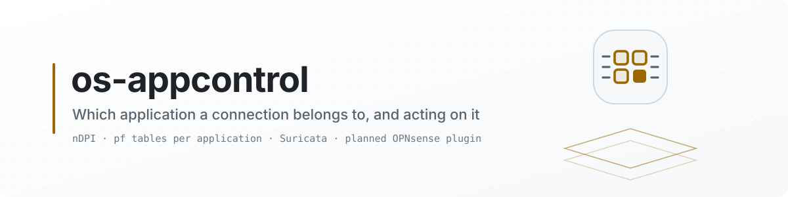

<picture>
  <source media="(prefers-color-scheme: dark)" srcset="docs/images/readme/banner-dark.svg">
  <source media="(prefers-color-scheme: light)" srcset="docs/images/readme/banner-light.svg">
  
</picture>

<p align="center">
  
  <a href="https://github.com/AbdelmonemAwad/os-appcontrol/actions/workflows/checks.yml"></a>
  <a href="LICENSE"></a>
  <a href="#what-is-tested"></a>
  <a href="https://github.com/AbdelmonemAwad/opnsense-arabic"></a>
  <a href="https://github.com/AbdelmonemAwad/os-xgs-npu"></a>
</p>

# Application Control for OPNsense

Knowing which application a connection belongs to - with the open nDPI library - and acting on it: pf tables per application for rules and for routing by gateway, Suricata rules, and a cut in the coprocessor once a connection is known.

> ~~**Planned - nothing here runs yet.** This repository was opened on 2026-11-16 to hold
> Application Control as a plugin of its own. No code has been written or moved into it, and there is no
> release.~~
>
> **Written, not released (2026-11-17).** The first part is here: each connection's application named
> by nDPI, on by default, and pf tables of the servers named - one for every nDPI category, one for each
> application chosen. Nothing is blocked yet. Nothing of it has run on an appliance yet: what was run is
> under [What is tested](#what-is-tested).

<p align="center"><b>Contents:</b> <a href="#what-it-does">What it does</a> &middot; <a href="#how-a-connection-is-named">How a connection is named</a> &middot; <a href="#not-yet-and-why">Not yet, and why</a> &middot; <a href="#what-is-tested">What is tested</a> &middot; <a href="#installation">Installation</a> &middot; <a href="#updates">Updates</a> &middot; <a href="#where-it-fits">Where it fits</a> &middot; <a href="#licence">Licence</a></p>

## What it does

**Firewall: Application Control** (XGS: Application Control, order 59, when os-xgs-npu is installed),
one page:

- **classification, on by default** - a service reads a copy of what the internal interfaces carry
  and names each connection's application with nDPI's `ndpiReader`, from OPNsense's own package
  `ndpi`. It stands in no connection's way: stopped, or failing, it changes no traffic;
- **tables** - every server nDPI names goes into the table of its category, `appcontrol_cat_<category>`,
  one for every category of the installed nDPI, and into `appcontrol_<application>` for each
  application chosen in Settings. Each is an alias of type External in Firewall: Aliases, written
  through OPNsense's own Alias model, so a rule's source or destination can name it, and so can XGS:
  Settings' "Cut open connections when listed". An address leaves its table once it has not been seen
  for the alias's Expire - 3600 s by default - carried out by OPNsense's own cron; seen again, its time
  starts again;
- **guesses** - a connection nDPI names only by its port or its address is shown as a guess and put in
  no table;
- **Unknown** - the connections nDPI could not name, the guesses, and those it named by their protocol
  alone - TLS, QUIC or HTTP with no application on top - each listed with its server, and the server
  name and JA4 fingerprint its client sent first, so its source can be found. The latest 500 are kept;
- **the cards** - applications named, connections classified, unknown, and the last error.

Off, the classifier stops and the plugin's aliases leave Firewall: Aliases - switched off instead where a
rule or a setting still names one.

## How a connection is named

The design is phase 0's, settled on 2026-11-17 by the plan, the new-plugin standard and a lab of nDPI
itself on a lab XGS 3300 and XGS 136 - nDPI's runs, not this plugin's:

- **read, never in the way** - on each internal interface (one with an address of its own and no
  gateway, unless Settings names others), `tcpdump -p` copies what the host sees through BPF to the
  service's pipe. `-p` leaves the port as it is: on an XGS 136 a front port made promiscuous is a
  request to the switch's agent, and `ndpiReader` reading a port itself always makes it promiscuous;
- **a connection's first packets** - the service keeps the first 16 packets of each connection, both
  ways, in the window of 60 seconds it began in; 10 seconds after a window ends, its packets go to
  `ndpiReader` as a small file. nDPI stops looking at a connection after its first 8 packets here
  (`--cfg=NULL,packets_limit_per_flow,8`), which was enough for every connection of phase 0's lab. A
  connection is never cut in two by a window's end; what it sends after its first 16 packets is
  counted, not kept;
- **twice, once without guessing** - `ndpiReader -C` writes a row for each connection it names, and
  leaves out those it cannot (phase 0's lab). It is run once as it is and once with `-d`, its own
  "use only DPI": a connection named only in the first run was named by a guess;
- **the server** - the end a connection's SYN went to, or, with no SYN, the end its first packet went
  to. A connection whose beginning was not seen - open before the service started - is not called
  unknown, and its server goes into no table;
- **its category** - the category nDPI's table of protocols (`ndpiReader -H`) gives its application, or
  its protocol when it has no application on top. The categories and the applications are those of
  the installed nDPI (`ndpiReader -a 1` and `-H`), read again each time the service starts;
- **JA4 and the server name** - read by the service from the client's first segments, put together:
  the ClientHello's server name, its first ALPN and its JA4 fingerprint as FoxIO's specification
  defines it. JA4 is read from TLS over TCP only; QUIC's ClientHello is encrypted, and for QUIC the
  server name is nDPI's.

Nothing holds a connection on the host until it is named: on an XGS, os-xgs-npu moves a connection
into hardware on its own schedule, and the service classifies what the host saw before that.

## Not yet, and why

- **anything on an appliance** - this branch was built and tested away from one (below). Not run yet:
  on the second XGS 3300, the XGS 136, a plain OPNsense; the page in a browser; `install.sh` and
  `uninstall.sh` on a firewall; the classifier's cost on a host's processors, its tables filling, an
  address expiring.
- **`ndpiReader -H` and `-a 1` read on a box** - their format here is the source's (nDPI's commit
  de5c784, the package's): `ndpi_dump_protocols()` and `ndpi_generate_options()`. Phase 0 ran both
  options on an XGS 3300 but did not keep their output. If `-a 1` gives nothing, `categories.json`,
  nDPI's categories as that commit names them, stands in; `apps.py check` says how the two differ.
- **a category given by a host name** - nDPI can give a connection a category of its own from its host
  list; the table here is its application's category from `-H`. How often the two differ is not
  measured.
- **blocking, and the cut in hardware** - phase 2 of the plan: a block rule the plugin registers, and
  the connections open to a blocked application cut, on a Sophos XGS in the coprocessor too.
- **Suricata rules, routing by gateway** - phases 3 and 4.
- **at line rate** - the service reads at most 2,000,000 packets an interface in a window; the rest of
  that window waits, and status.json counts the windows cut short - the page does not show it yet.
  Neither the cost nor the rate it holds is measured.

## What is tested

On 2026-11-17, from this branch, away from an appliance - the checks, run under Python 3.14 and PHP 8.5:

- **the classifier** - `tools/test-classify.py`, 111 checks:
  - ndpiReader's CSV as phase 0's lab read it on an XGS 3300 with ndpi-6.0.d20260909,1
    (`tools/fixtures/lab-*.csv`, every address made a documentation one): the connections and names
    the lab counted - TLS.Wikipedia, TLS.Cloudflare and TLS.Mozilla 11 each and DNS 8, TLS.YouTube 12
    and TLS.Twitch 12, HTTP.Canonical 20, SMTP 5 - and a file of the header alone giving none;
  - the catalogue: categories and protocols from `-a 1` and `-H` in the source's format, and
    `categories.json` in their stead;
  - the alias names: at most 31 characters, `_` for any other character, a long one cut with a suffix
    of its own, every category's name its own;
  - the capture, on packets built byte by byte: the pcap stream in chunks, a connection's server, the
    ClientHello put together from two segments, in order or not, and the JA4 of FoxIO's own example,
    `t13d1516h2_8daaf6152771_e5627efa2ab1`; IPv6 behind a VLAN tag and an extension header; padding,
    fragments, tunnels; the first 16 packets of a connection kept in its window and the rest counted;
  - each connection named, guessed or unknown, and what goes into which table: a guess, an unknown
    connection, one open before the start and a row no capture matched never do; an address new to a
    table added, one there refreshed; the Unknown list kept to its latest 500;
  - the interfaces read by default: the internal ones - not the WAN, static or not, nor one with a
    gateway or an address from upstream;
  - a packet the reader cannot make sense of counted, and the capture going on;
  - one run of the service with stand-in `tcpdump` and `ndpiReader` programs and a stand-in `pfctl`:
    `tcpdump -p -U`, ndpiReader twice, the tables, status.json and unknown.json, its files removed and
    tcpdump stopped when it ends; and nDPI missing, said;
  - `status.py`: each application with its table and the addresses pf holds there, the category
    tables, and a pidfile believed only when its process is the classifier;
- **the aliases** - `tools/test-aliases.php`, 17 checks, with stand-ins for OPNsense's Alias model: an
  External alias with Expire made for each table, its Expire refreshed, nothing written when nothing
  changed, the owner's alias of the same name left; on removal every alias of the plugin's taken out,
  switched off instead where a rule or XGS: Settings still names it; `aliases.php` saving only after a
  clean validation, and touching nothing when the names cannot be read or `tables.py` fails;
- **the page's API** - `tools/test-mvc.php`, 15 checks, with stand-ins for OPNsense's MVC base: the
  status passed on and an answer it cannot read said, the grids' rows, and Apply's order - the aliases,
  the filter, cron, the tables of aliases gone, the classifier started again or stopped when off -
  with nothing done after aliases not written, nor for a GET;
- **the installation** - `tools/test-install.py`, 31 checks: `install/install.sh`,
  `install/uninstall.sh`, the package's `post-install.sh`, `pre-deinstall.sh` and `post-deinstall.sh`,
  and `place-menu.sh`, in a temporary root with stand-ins for `service`, `configctl`, `pkg`, `pfctl` and
  `pkill`: every file laid down with its mode and taken away, the menu in XGS (59) or Firewall, nothing
  copied when a file has a syntax error, the package `ndpi` installed when missing and removed only when
  the installer installed it and nothing needs it, the classifier started on by default or stopped when
  off, the classifier stopped and the aliases taken out before the files go, the tables of aliases gone
  emptied, and nothing done by the old package in an upgrade;
- **the self-update** - `tools/test-self-update.py`, 45 checks, as os-blocklists has it;
- **the strings** - `tools/check-strings.py`: each of the 155 strings the GUI shows is in `source.json`,
  nDPI's 93 category names among them through the page's map (`tools/gen-data-strings.py`); 38 had
  their Arabic in opnsense-arabic that day, and the other 117 wait for it;
- **the rest of the checks** - every installed file removed by the uninstaller
  (`tools/check-uninstall.sh`), `php -l`, `py_compile` and pyflakes, `sh -n`, XML and JSON, nothing
  private, no Arabic in the code, the copyright line; and, by hand, the page kit and the page's script
  run once under node with a stand-in jQuery.

64 behaviours those tests cover were taken out in turn, on a copy, and the tests failed on each:
among them a guess judged as named, a connection open before the start put in a table, the WAN read
by default, `tcpdump` run without `-p`, the DPI run without `-d`, every packet of a connection kept,
the JA4's sorting, GREASE and supported_versions, an address seen again added instead of refreshed,
an alias made without Expire, one a rule names removed, Apply going on after the aliases failed, the
aliases taken out after the files, and `ndpi` removed though another package needs it. A first run
had found 7 of them untested: the tests reach 6 now, and the seventh changed nothing - a row with a
"|" in its last column is read either way.

Not tested: anything on an appliance (above).

## Installation

It is not in the OPNsense plugin repository, so there is no `pkg install os-appcontrol`, and there is
no release yet.

**From a checkout** of this repository, on the firewall, as root:

```sh
sh install/install.sh
```

It checks the PHP with `php -l` and the Python with `py_compile` before anything is copied, installs
the package `ndpi` when it is not there (it needs the package mirror), copies `src/` onto `/usr/local`,
puts the page in the menu (`place-menu.sh`: XGS with os-xgs-npu, Firewall without), writes the aliases,
reloads the filter and cron, starts the classifier, and records the commit for the self-update. Safe to
run again: the settings in config.xml are kept.

`sh install/uninstall.sh` stops the classifier, takes the plugin's aliases out of Firewall: Aliases
(switched off instead where a rule or a setting still names one), removes its files and its state,
empties the tables of the aliases gone, and removes the package `ndpi` only when `install.sh`
installed it and no other package needs it. The settings stay in config.xml.

**From a package**, once there is a release: `tools/make-package.sh` builds it on a firewall, and
`release.yml` in a FreeBSD virtual machine for each release, as os-blocklists does. The package
depends on `ndpi`.

## Updates

As os-blocklists: taken by hand, to this repository's **releases** - from **XGS: Updates**, its
*Plugins* tab, where an os-xgs-npu that lists this plugin is installed, or by running
`/usr/local/opnsense/scripts/appcontrol/self-update.py` (`check` to ask). A release is installed only as
its owner signed it (`release.json` and its Ed25519 signature, the public key in `release-keys/`), only
forward, by the `install/install.sh` it carries. No cron entry runs it.

## Where it fits

It is one part of the [os-xgs-npu](https://github.com/AbdelmonemAwad/os-xgs-npu) project, which puts OPNsense on Sophos XGS hardware, and works the way its other plugins do: changes by pull request, a release installed from **XGS: Updates**, its Arabic in [opnsense-arabic](https://github.com/AbdelmonemAwad/opnsense-arabic)'s catalogue. It installs the same on a plain OPNsense, where pf alone holds the tables and the page says so.

## Licence

BSD 2-Clause - see [LICENSE](LICENSE).
